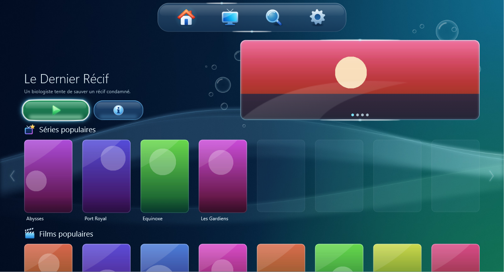
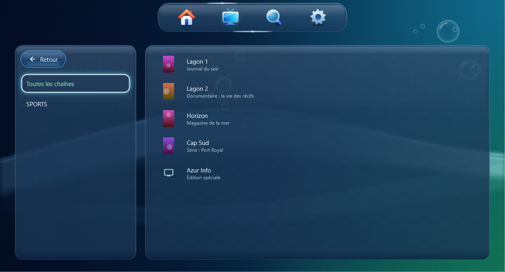
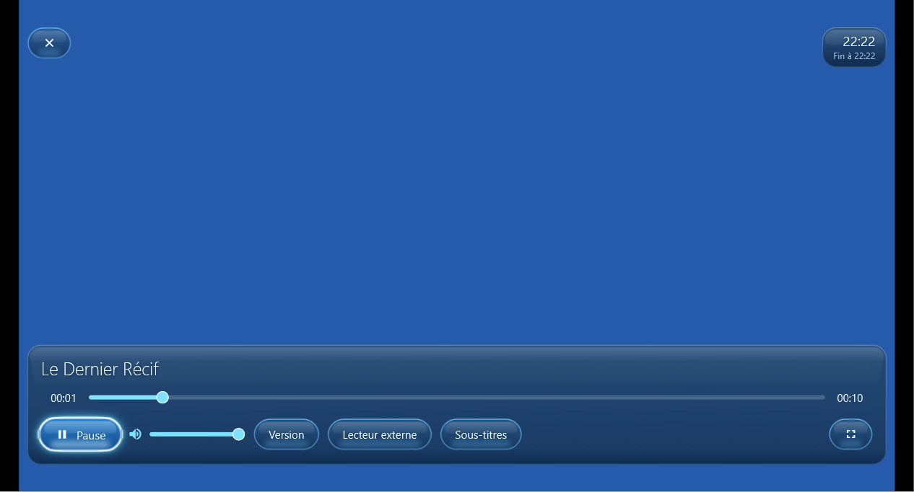
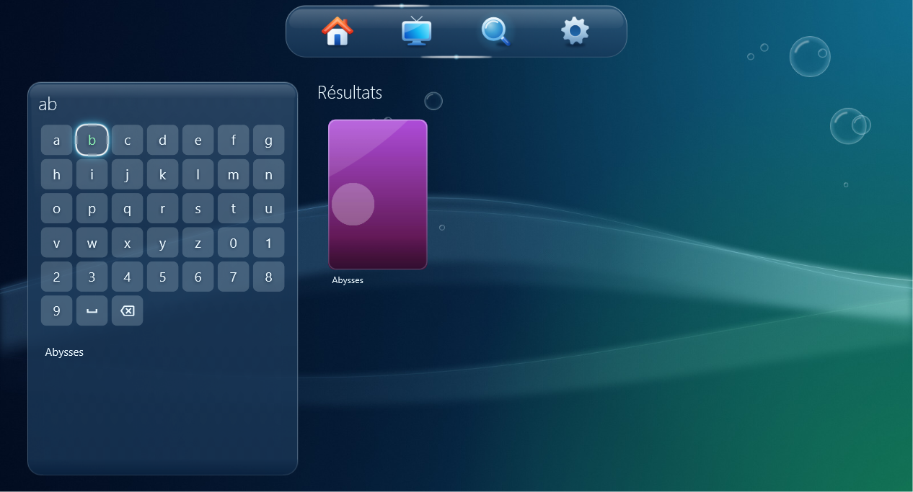
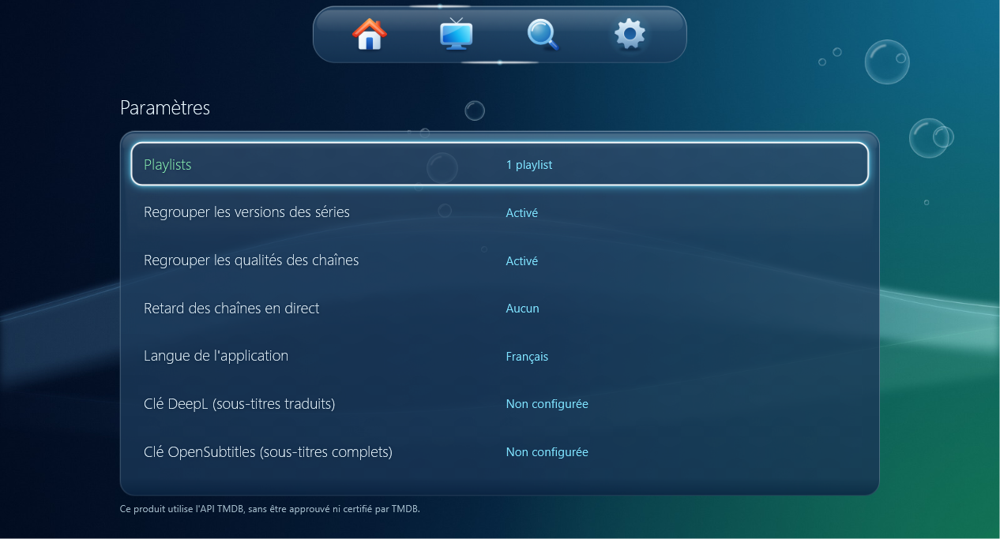

  

<h1 align="center">Aero IPTV</h1>

  <strong>Your channels, movies and series on TV and PC, in an interface made of glass and water.</strong> 
  For Android TV, Fire TV and Windows. Free, no account, no ads.

  

  
  &nbsp;
  

  

## Install

Pick your device. The download starts right away.

| Device | File | |
|---|---|---|
| Windows 10 or 11 PC (64-bit) | `.zip` archive |  |
| All Fire TV Sticks, 32-bit Android boxes | 32-bit `.apk` |  |
| 64-bit Android TVs and boxes | 64-bit `.apk` |  |

All versions are on the [releases page](https://github.com/B2TN/aero-iptv/releases).

<strong>Install on Windows</strong>

1. Download the archive, right-click it and choose **Extract All**.
2. Open the extracted folder and run `aero_iptv.exe`. Keep all the files together: the app needs them.
3. If Windows shows "Windows protected your PC", click **More info**, then **Run anyway**. This message appears for any app without a paid signature.

<strong>Install on Fire TV</strong>

1. On your Fire TV, install the free **Downloader** app from the Appstore.
2. In **Settings**, **My Fire TV**, **Developer options**, allow apps from unknown sources for Downloader.
3. In Downloader, enter the address of the **Fire TV Stick** button above, then install the file.

<strong>Install on Android TV</strong>

1. Copy the `.apk` file to a USB drive, or download it with an app such as Downloader.
2. Open it with a file manager, then allow the installation when the TV asks.
3. If the TV refuses the 64-bit version, install the one from the **Fire TV Stick** button: it works everywhere.

### First launch

Add your M3U playlist or your Xtream Codes login, and you're ready. Aero IPTV is a player: it provides **no channels and no content**. You need a playlist or a subscription from a provider.

## What's inside

- **A welcoming home screen**: featured picks, trending titles, and resume where you left off.
- **Live TV**: channels by group, with what's on now.
- **One page per movie or series**: all versions and languages in one place.
- **Full playback controls**: audio tracks, subtitles, 30-second jumps, skip intro, next episode.
- **Translated subtitles** in the language of your choice.
- **Real remote-control navigation**, plus mouse support on Windows.
- **Single-connection subscriptions** are supported.
- **Five languages**: English, French, Spanish, German and Arabic.

## Preview

<table>
  <tr>
    <td></td>
    <td></td>
  </tr>
  <tr>
    <td></td>
    <td></td>
  </tr>
</table>

The titles and posters in these screenshots are made up for the demo. The interface is shown in French.

## Your feedback shapes the app

Aero IPTV is a young project built in spare time. Every bit of feedback counts: a first impression, a confusing screen, a channel that won't start, an idea. All you need is a free GitHub account, and the form takes a minute.

  

  
  &nbsp;
  

Feedback is public: **never post your username, password or playlist address.**

The Windows version has seen the most use. The Android versions have been tested on an emulator, not yet on a real Fire TV Stick, so feedback from those devices is especially useful.

## Translated subtitles (optional)

Two free services add translation, each with your own key, entered in **Settings**:

| Key | What it does |
|---|---|
| [DeepL](https://www.deepl.com/your-account/keys) | Translates the subtitle lines of the video as you watch |
| [OpenSubtitles](https://www.opensubtitles.com/consumers) | Finds a complete file, translated in one go as soon as you pick it. It may be slightly out of sync, since it comes from a different source than the video |

Subtitles drawn as images (PGS, VobSub) contain no text and can't be translated.

## Your data

- Your login details stay on your device, encrypted by the system vault (DPAPI on Windows, Keystore on Android), and are only sent to your provider.
- No account, no ads, no analytics.
- The app only contacts your provider, Apple's public charts for the home screen trends, and the services whose key you've entered.

## Content and rights

Aero IPTV does not provide, host or recommend any content. You are responsible for what you open with it: only use sources you have the right to watch. Playlist links are not accepted in feedback.

## For developers

The project is written in Flutter, with media_kit (libmpv) for playback and Drift for the local database. Everything is in the [development guide](docs/DEVELOPPEMENT.md) (in French).

## License

© 2026 B2TN. Aero IPTV's code is released under the [GPL v3 license](LICENSE): you can use, modify and redistribute it, as long as your versions stay open under the same license. See also the [third-party licenses](docs/LICENCES_TIERS.md) (in French).
