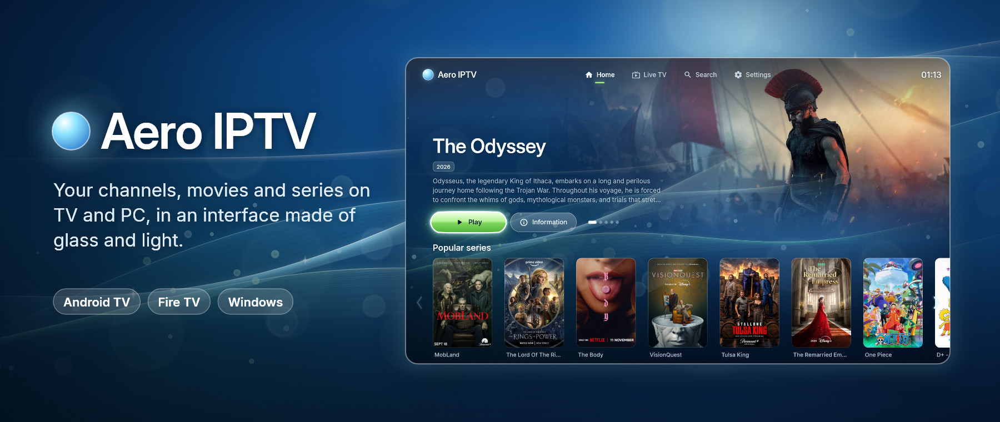
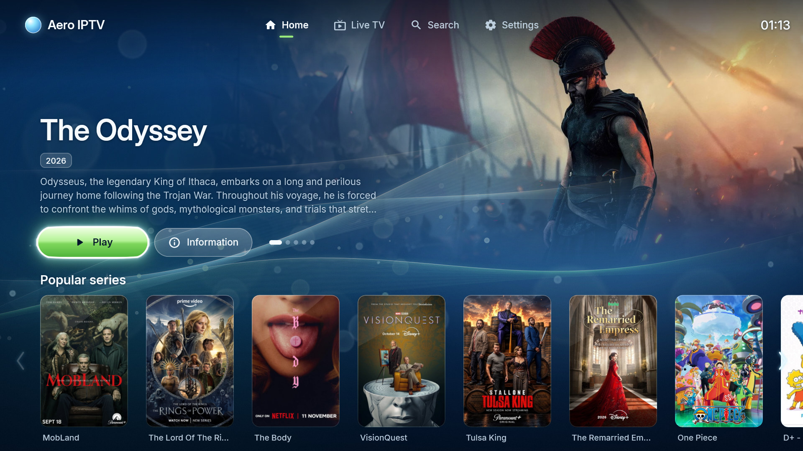
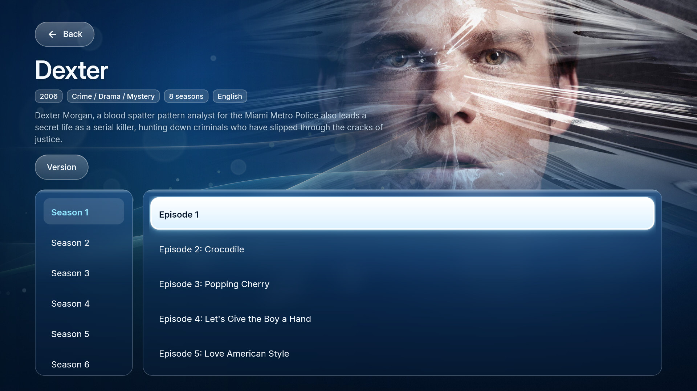
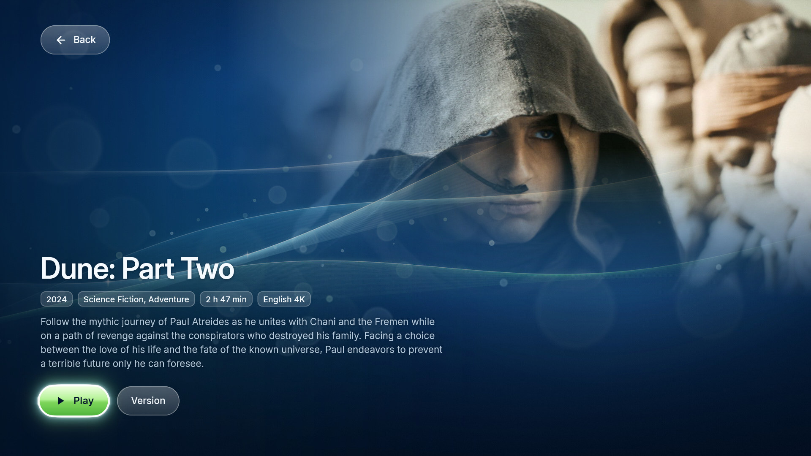
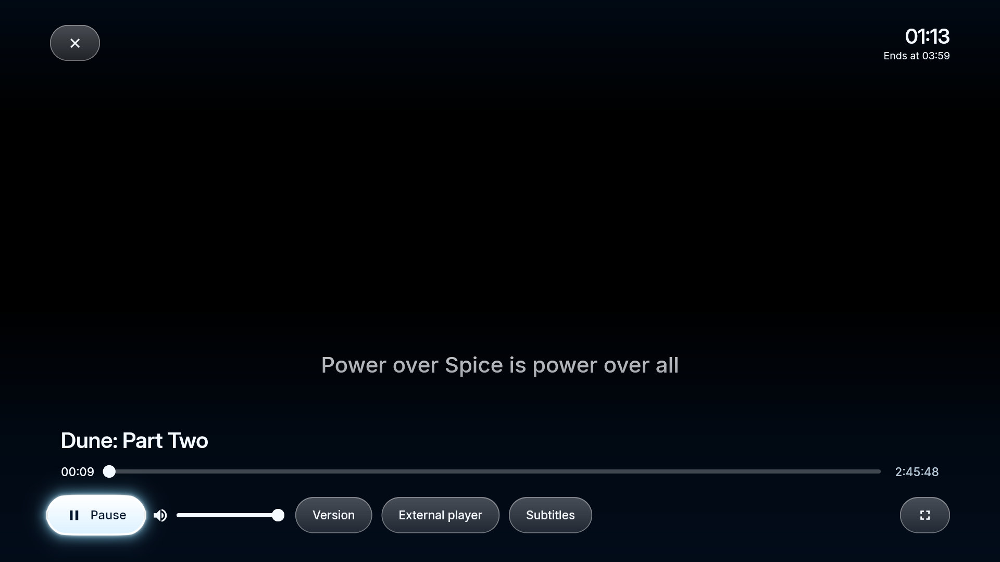
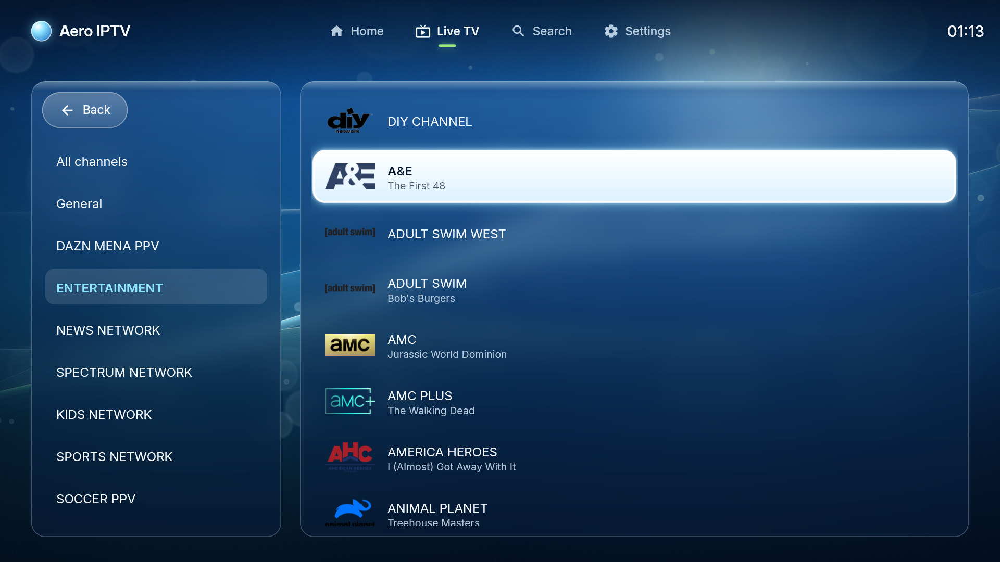
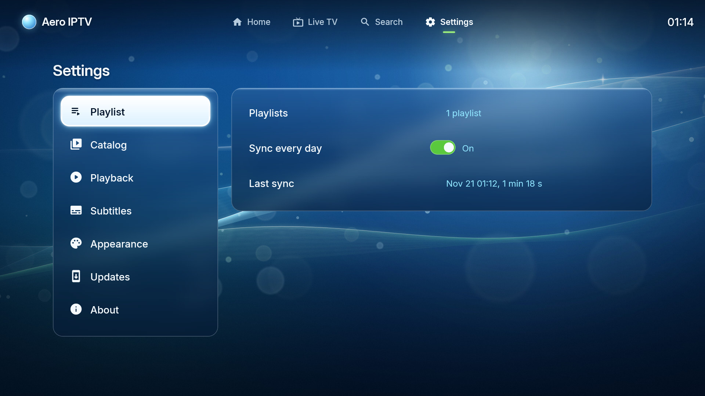
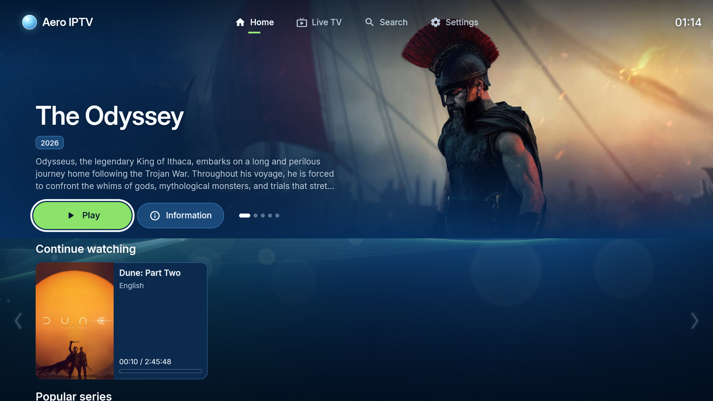

  

  
  
  

  Free and open source. No account, no ads, no tracking. 
  A player for your own playlist: it provides no channels and no content.

Aero IPTV plays your IPTV subscription on the TV and the PC, designed first for the remote. Its look comes from the Frutiger Aero style of the late 2000s, with deep blue, glass and ribbons of light. Underneath, it works like the streaming apps you already know: a home screen of what's popular, one page per title, and playback that picks up where you left off.

What changes from one version to the next is on the [releases page](https://github.com/B2TN/aero-iptv/releases).

## A home screen made for the couch

- **A featured title in full frame**: its large image blends into the background, with its summary, **Play** and **Information**.
- **Continue watching**: a movie resumes where you stopped, a series on its furthest episode, then moves on to the next one. A series you've caught up on stays at the end of the row while its next episode is announced, with "Next episode in 3 days".
- **Favorites**, then **popular series and movies** in your country, picked from what's popular right now and limited to the titles in your playlist.
- **A menu on every title**: hold OK, press the remote's Menu key or right-click to play or resume, choose a version, or add it to your favorites.

## One page per movie and series

- **A full-screen page** with the title's large image, its summary, year, genre, runtime or number of seasons.
- **Every version in one place**: the languages and qualities your provider offers become versions of the same page, with a **Version** button. Grouping can be turned off for movies, series and channels.
- **Seasons and episodes** with their own titles and summaries, a check once watched and a progress bar when started. Your position is shared by all versions: an episode started in one language resumes at the same point in another.
- **Upcoming episodes** with their air dates. An episode that aired but isn't in your playlist yet reads "Late on IPTV".
- **An episode menu**: resume or start over, mark it watched or unwatched, mark every episode up to this one, the whole season, or play it in another version.

## A player you drive with the remote

- **The essentials within reach**: pause, a time bar with 30-second jumps from the arrows or the fast-forward and rewind keys, and the time the movie ends.
- **Audio tracks, subtitles and versions** during playback, and an **External player** button to open the stream in another app.
- **Episodes** without leaving playback, for series.
- **Skip intro** and **Next episode**, offered during the intro and the end credits when the video file or a community database knows where they are.
- **Your position is saved** every few seconds and when you leave, and survives a power cut.
- On Windows: volume, full screen and mouse control.

## Live TV

- **Channels by country, then by group**, with what's on now from your TV guide.
- **"All channels" follows the national numbering** in France, Belgium, Switzerland, the United Kingdom, Germany, Spain, Italy, Portugal and the Netherlands.
- **Several qualities of a channel make one entry**: you pick the stream when you open it.
- **Favorite channels** gather in a tile shown first.
- A **live delay** setting steadies playback on unstable streams.

## Search

- **Movies and series by title**, with suggestions as you type. Accents and capitals don't matter.
- **Popular titles** are shown before you type.
- An **on-screen keyboard made for the remote** on TV, and your physical keyboard on Windows.

## Subtitles your way

- **Subtitles from the video itself**: the app downloads none.
- **Their appearance**: size, font, color, edge, background, opacity and position, with a live preview.
- **Translated subtitles** in the language of your choice, with a free [DeepL](https://www.deepl.com/your-account/keys) key entered in **Settings**, **Subtitles**. Subtitles drawn as images (PGS, VobSub) contain no text to translate.

## Your catalog stays up to date

- **M3U playlists**, with an optional XMLTV guide, and **Xtream Codes** accounts. You can keep several playlists and switch between them.
- **A daily sync** in the background, never during playback. Only what changed reaches your catalog: favorites, history and loaded summaries stay. **Last sync** shows how long each step took.
- **Single-connection subscriptions** are supported.
- **Settings sorted into categories**: Playlist, Catalog, Playback, Subtitles, Appearance, Updates and About.

## Made for TV, comfortable on PC

- **Every screen works with the D-pad**, and the focused item turns white so you can spot it from the couch.
- **Mouse and keyboard** on Windows.
- **Five languages**: English, French, Spanish, German and Arabic, right to left included.
- **A short tutorial** on the first launch: language, playlist, Performance mode and a tour of the main features. **Settings**, **About** opens it again.
- **Updates from the app**: a banner offers each new version and installs it, keeping your playlist, favorites and history. **Beta updates** offers test versions before their release.

## Performance mode

Small devices such as the Fire TV Stick have little memory and a modest graphics chip. Performance mode keeps the same screens without blur, animation or blended effects: the glass becomes solid, and the background stays still and lighter in memory. It turns itself on for low-memory devices, and you can switch it in **Settings**, **Appearance**.

## Install

| Device | File |
|---|---|
| Windows 10 or 11 PC (64-bit) | [Installer, `.exe`](https://github.com/B2TN/aero-iptv/releases/latest/download/aero-iptv-windows-x64-setup.exe), or the [portable `.zip`](https://github.com/B2TN/aero-iptv/releases/latest/download/aero-iptv-windows-x64.zip) |
| Fire TV Stick, Android TVs and boxes | [`.apk`](https://github.com/B2TN/aero-iptv/releases/latest/download/aero-iptv-fire-tv-armeabi-v7a.apk), the same file for all |

<strong>Install on Windows</strong>

1. Run `aero-iptv-windows-x64-setup.exe`. It installs Aero IPTV in your user profile, without administrator rights, and adds it to the Start menu.
2. If Windows shows "Windows protected your PC", click **More info**, then **Run anyway**. This message appears for any app without a paid signature.

The portable `.zip` works too: extract it, keep all the files together, and run `aero_iptv.exe`. Both share the same playlist and history.

<strong>Install on Fire TV</strong>

1. On your Fire TV, install the free **Downloader** app from the Appstore.
2. In **Settings**, **My Fire TV**, **Developer options**, allow apps from unknown sources for Downloader.
3. In Downloader, enter the address of the **Download for Fire TV** button above, then install the file.

<strong>Install on Android TV</strong>

1. Copy the `.apk` file to a USB drive, or download it with an app such as Downloader.
2. Open it with a file manager, then allow the installation when the TV asks.

The same file works on 32-bit and 64-bit TVs.

## Add your playlist

You need a playlist or a subscription from a provider. On the first launch, the tutorial helps you add it:

- an **Xtream Codes** login: the server address, your username and your password;
- or an **M3U** playlist address, with an optional XMLTV guide address.

The app then imports your catalog. A large catalog takes a few minutes the first time; after that, the daily sync only processes what changed.

## FAQ

<strong>Does Aero IPTV come with channels?</strong>

No. It only plays the playlist or subscription you add. Aero IPTV does not provide, host or recommend any content.

<strong>The first import is long. Is that normal?</strong>

Yes, for large catalogs: hundreds of thousands of titles take a few minutes the first time. **Settings**, **Playlist**, **Last sync** shows where the time went.

<strong>Why is the popular list different from my friend's?</strong>

It depends on your country and on your playlist: the app only shows popular titles you can actually watch. The country comes from your IP address; you can pick another one in **Settings**, **Catalog**, which helps with a VPN.

<strong>A movie or a channel won't start.</strong>

Try another version from its page or from the player, or **External player** to open it in another app. If it still fails, [report a bug](https://github.com/B2TN/aero-iptv/issues/new?template=bug.yml) with the device and what you see, but never your playlist address or login.

## Your feedback shapes the app

Aero IPTV is a young project built in spare time. Every bit of feedback counts: a first impression, a confusing screen, a channel that won't start, an idea. All you need is a free GitHub account, and the form takes a minute. On TV, **Settings**, **About**, **Report a problem** shows a QR code that opens it on your phone.

   
  
  

Feedback is public: **never post your username, password or playlist address.**

## Your data

- Your login details stay on your device, encrypted by the system vault (DPAPI on Windows, Keystore on Android), and are only sent to your provider.
- No account, no ads, no analytics.
- The app only contacts your provider, the services listed here, and DeepL if you've entered a key.
- Once a day, the popular titles come from [TMDB](https://www.themoviedb.org), or from Apple's public charts in builds without a TMDB key. They only receive a country code. On a title's page, its large image may come from TMDB, which then receives its title and year.
- To know your country, the app asks [country.is](https://country.is) once which country your IP address is in, and keeps only the country code. You can also pick the country in **Settings**.
- To find the intro and the end credits of an episode, it asks [TheIntroDB](https://theintrodb.org), [IntroDB](https://introdb.app) and [TVmaze](https://www.tvmaze.com). They only receive the series title, its public IDs, and the season and episode numbers.
- To list the upcoming episodes of a series, it asks TVmaze with the series title only.

## Content and rights

Aero IPTV does not provide, host or recommend any content. You are responsible for what you open with it: only use sources you have the right to watch. Playlist links are not accepted in feedback.

## For developers

The project is written in Flutter, with media_kit (libmpv) for playback and Drift for the local database. Everything is in the [development guide](docs/DEVELOPMENT.md).

## License

© 2026 B2TN. Aero IPTV's code is released under the [GPL v3 license](LICENSE): you can use, modify and redistribute it, as long as your versions stay open under the same license. The Inter and Noto Sans Arabic typefaces are under the SIL Open Font License. See the [third-party licenses](docs/THIRD_PARTY_LICENSES.md).
